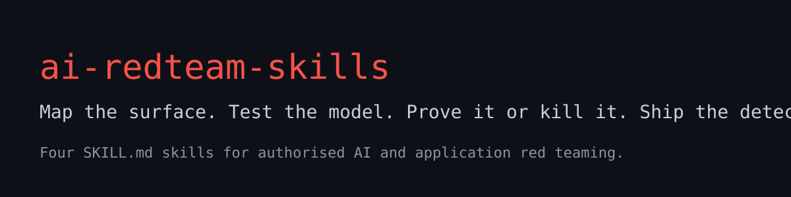

# ai-redteam-skills

[](https://github.com/Epsilon0xCell/ai-redteam-skills/releases) [](LICENSE) [](https://github.com/Epsilon0xCell/ai-redteam-skills/stargazers)



**Your agent can run the tools. These skills make it run a red-team engagement like the finding has to survive review.**

Most agent security work fails in the same three places: the recon is a pile of scan output nobody counted, the finding is a scanner verdict nobody reproduced, and the report ends where the defender's work should begin. This pack is four skills, one per failure, in the SKILL.md format any coding agent can read.

For authorised testing only: labs, CTFs, and engagements with written permission. The skills themselves enforce that framing; every workflow opens with a scope check and every example uses fixtures.

## Install

```sh
git clone https://github.com/Epsilon0xCell/ai-redteam-skills.git
cd ai-redteam-skills
./install.sh
```

That copies the four skills into `~/.claude/skills`. Set `SKILLS_DIR` to install somewhere else. The skills are plain markdown, so any agent that reads skill files can use them; nothing here is tied to one vendor.

Then, at the start of an engagement:

> Run target-recon on this lab target and give me the surface ledger with scored leads.

## Contents

- [Install](#install)
- [What is in the pack](#what-is-in-the-pack)
- [The worked example](#the-worked-example)
- [Why the verification skill is the centre](#why-the-verification-skill-is-the-centre)
- [Honest limits](#honest-limits)
- [Contributing](#contributing)
- [License](#license)

## What is in the pack

| Skill | Job |
|---|---|
| `target-recon` | Passive-first reconnaissance and attack-surface mapping. Ends in a counted surface ledger where every service is ticked exhausted or named unexplored, plus leads scored by evidence, chain value, reuse, horizon, and novelty cost. |
| `prompt-injection-testing` | Direct and indirect prompt-injection testing for LLM applications. A benign control for every probe, escalation in order of subtlety, and verdicts that separate a real boundary break from a model being agreeable. |
| `verification-poc` | The proof gate. A candidate becomes a finding only when it is reproduced, controlled, minimal, proven end to end, and re-run from a fresh state. Its most valuable output is a killed candidate. |
| `detection-pairing` | Every confirmed finding ships with its detection: the observable from the actual run, the telemetry blind spot named by shape, a tested rule sketch, and the missing log field called out when the rule cannot be built today. |

## The worked example

`examples/confirmed-prompt-injection/` runs the whole chain on a fixture application: an instruction seeded in a retrieved document makes a support assistant leak another customer's order. Control, proof, negative test against the fixed build, and the detection pair, all in one short read. It is the fastest way to understand what the pack considers a finding.

## Why the verification skill is the centre

The other three skills produce candidates and coverage. Verification decides what is true. Its rule is the one this pack is built around: severity follows the demonstrated gain, a crash is not impact, a behaviour the documentation promises is not a vulnerability, and a candidate with a missing leg is reported as unconfirmed with the leg named, or not reported at all. That discipline is what makes the confirmed findings worth a defender's time.

## Honest limits

- Skills structure the work; they do not replace judgement about scope, authorisation, or a specific target's behaviour.
- The pack covers recon, LLM injection testing, verification, and detection. It is not an exploitation framework and ships no payloads against real products.
- Worked examples use fixtures. Real engagements differ in detail; the workflows are written to be followed step by step, not skimmed.

## Contributing

New skills and worked examples are the contributions that matter, and every change is grounded in a case from real use. See CONTRIBUTING.md.

## License

MIT. Written by Gavin Blacklock ([Epsilon0xCell](https://github.com/Epsilon0xCell)). Defensive counterpart: [secure-coding-skills](https://github.com/Epsilon0xCell/secure-coding-skills), the pack that makes a coding agent audit its own diff before a PR.
